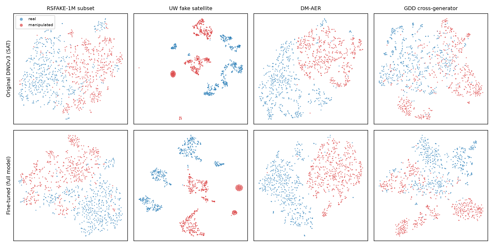
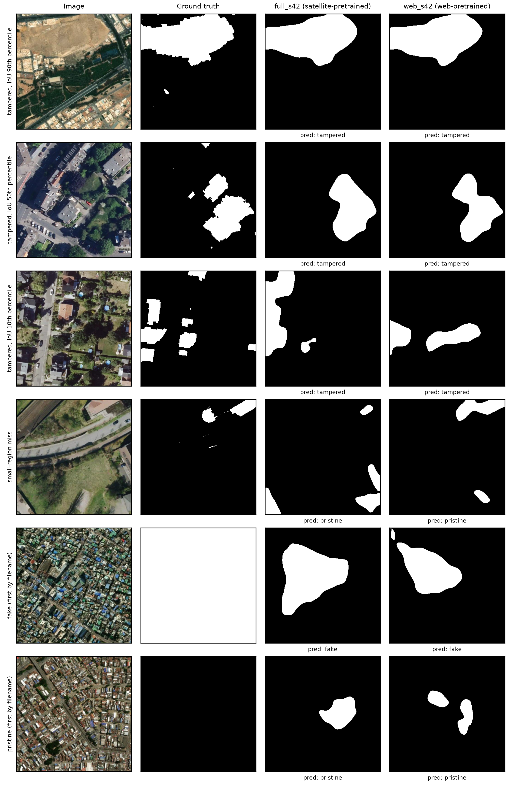

# Supplementary Material

Detecting AI-Generated Satellite Imagery Deepfakes Using DINOv3

DRAFT generated 2026-11-26 by make_supplement.py from the result files in the repository. Entries marked 'pending' belong to runs that have not finished.

## S1. Zero-shot evaluation on outside datasets

Each checkpoint is applied without any adaptation. Score: P(manipulated) = P(tampered) + P(fake). AUC with bootstrap 95% interval (2000 resamples within class). 'Det. @0.5' and 'FA @0.5' are the detection and false-alarm rates at the fixed threshold 0.5. 'Det. @5% FA' sets the threshold on the real images of the same dataset; it is an oracle operating point, not a zero-shot number.

| Checkpoint | Dataset | Real | Manip. | AUC [95% CI] | Det. @0.5 | FA @0.5 | Det. @5% FA |
|---|---|---|---|---|---|---|---|
| Full model (SAT), seed 42 | RSFAKE-1M subset | 5000 | 5000 | 0.584 [0.573, 0.595] | 0.108 | 0.040 | 0.123 |
| Full model (SAT), seed 42 | UW fake satellite | 4032 | 4032 | 0.500 [0.487, 0.513] | 0.033 | 0.034 | 0.044 |
| Full model (SAT), seed 42 | DM-AER (size-matched) | 494 | 1000 | 0.780 [0.753, 0.803] | 0.112 | 0.006 | 0.272 |
| Full model (SAT), seed 42 | GDD in-domain | 750 | 750 | 0.536 [0.507, 0.565] | 0.085 | 0.016 | 0.120 |
| Full model (SAT), seed 42 | GDD cross-generator | 1000 | 1000 | 0.648 [0.625, 0.673] | 0.076 | 0.016 | 0.120 |
| Full model (SAT), seed 42 | GDD cross-domain | 1000 | 1000 | 0.706 [0.684, 0.728] | 0.076 | 0.000 | 0.169 |
| Full model (SAT), seed 42 | GDD local edits | 500 | 500 | 0.568 [0.532, 0.603] | 0.060 | 0.012 | 0.114 |
| Full model (SAT), seed 42 | fmow-fake-small (120 images) | 60 | 60 | 0.450 [0.350, 0.556] | 0.000 | 0.000 | 0.067 |
| Web backbone, seed 42 | RSFAKE-1M subset | 5000 | 5000 | 0.668 [0.657, 0.678] | 0.105 | 0.025 | 0.156 |
| Web backbone, seed 42 | UW fake satellite | 4032 | 4032 | 0.527 [0.514, 0.539] | 0.036 | 0.040 | 0.041 |
| Web backbone, seed 42 | DM-AER (size-matched) | 494 | 1000 | 0.738 [0.713, 0.763] | 0.184 | 0.014 | 0.317 |
| Web backbone, seed 42 | GDD in-domain | 750 | 750 | 0.481 [0.450, 0.510] | 0.047 | 0.013 | 0.129 |
| Web backbone, seed 42 | GDD cross-generator | 1000 | 1000 | 0.596 [0.571, 0.621] | 0.073 | 0.014 | 0.135 |
| Web backbone, seed 42 | GDD cross-domain | 1000 | 1000 | 0.634 [0.610, 0.658] | 0.073 | 0.004 | 0.170 |
| Web backbone, seed 42 | GDD local edits | 500 | 500 | 0.560 [0.525, 0.596] | 0.054 | 0.012 | 0.132 |
| Web backbone, seed 42 | fmow-fake-small (120 images) | 60 | 60 | 0.432 [0.331, 0.536] | 0.000 | 0.000 | 0.083 |
| Frozen backbone, seed 42 | RSFAKE-1M subset | 5000 | 5000 | 0.543 [0.531, 0.554] | 0.270 | 0.207 | 0.051 |
| Frozen backbone, seed 42 | UW fake satellite | 4032 | 4032 | 0.716 [0.705, 0.726] | 0.336 | 0.119 | 0.069 |
| Frozen backbone, seed 42 | DM-AER (size-matched) | 494 | 1000 | 0.759 [0.730, 0.786] | 0.372 | 0.138 | 0.159 |
| Frozen backbone, seed 42 | GDD in-domain | 750 | 750 | 0.515 [0.485, 0.548] | 0.317 | 0.164 | 0.193 |
| Frozen backbone, seed 42 | GDD cross-generator | 1000 | 1000 | 0.541 [0.515, 0.567] | 0.224 | 0.158 | 0.080 |
| Frozen backbone, seed 42 | GDD cross-domain | 1000 | 1000 | 0.550 [0.525, 0.575] | 0.224 | 0.151 | 0.089 |
| Frozen backbone, seed 42 | GDD local edits | 500 | 500 | 0.505 [0.469, 0.542] | 0.142 | 0.160 | 0.036 |
| Frozen backbone, seed 42 | fmow-fake-small (120 images) | 60 | 60 | 0.359 [0.266, 0.460] | 0.050 | 0.100 | 0.017 |

Table S1. Zero-shot detection on outside datasets.

## S2. Zero-shot results per generator / manipulation type

Each manipulated group is scored against all real images of its dataset (full model, seed 42).

| Dataset | Group | n | AUC vs reals | Det. @0.5 | Det. @5% FA |
|---|---|---|---|---|---|
| RSFAKE-1M subset | generated_RSSD_768 | 500 | 0.268 | 0.002 | 0.002 |
| RSFAKE-1M subset | generated_SDFRS | 500 | 0.816 | 0.280 | 0.310 |
| RSFAKE-1M subset | generated_crsdiff | 500 | 0.764 | 0.150 | 0.178 |
| RSFAKE-1M subset | generated_diffusion_sat | 500 | 0.574 | 0.038 | 0.052 |
| RSFAKE-1M subset | generated_diffusion_sat_256 | 500 | 0.804 | 0.224 | 0.254 |
| RSFAKE-1M subset | generated_geosynth | 500 | 0.387 | 0.006 | 0.012 |
| RSFAKE-1M subset | generated_geosynth_canny | 500 | 0.512 | 0.042 | 0.050 |
| RSFAKE-1M subset | generated_geosynth_sam | 500 | 0.407 | 0.016 | 0.020 |
| RSFAKE-1M subset | generated_mapsat | 500 | 0.527 | 0.058 | 0.068 |
| RSFAKE-1M subset | generated_rsinpaint | 500 | 0.778 | 0.264 | 0.284 |
| UW fake satellite | fake/Beijing_style | 2016 | 0.395 | 0.007 | 0.014 |
| UW fake satellite | fake/Seattle_style | 2016 | 0.605 | 0.058 | 0.075 |
| DM-AER (size-matched) | validation/FAKE | 1000 | 0.780 | 0.112 | 0.272 |
| GDD in-domain | gen/diffusionsat | 150 | 0.599 | 0.007 | 0.013 |
| GDD in-domain | gen/flux2dev | 150 | 0.179 | 0.000 | 0.000 |
| GDD in-domain | gen/flux2kleinbase4b | 150 | 0.196 | 0.000 | 0.000 |
| GDD in-domain | gen/neds | 150 | 0.894 | 0.340 | 0.447 |
| GDD in-domain | gen/r3gan | 150 | 0.812 | 0.080 | 0.140 |
| GDD cross-generator | gen/geosynth | 334 | 0.709 | 0.006 | 0.015 |
| GDD cross-generator | gen/rspaint | 333 | 0.836 | 0.222 | 0.342 |
| GDD cross-generator | gen/sd35medium | 333 | 0.400 | 0.000 | 0.003 |
| GDD cross-domain | gen/geosynth | 334 | 0.770 | 0.006 | 0.066 |
| GDD cross-domain | gen/rspaint | 333 | 0.877 | 0.222 | 0.435 |
| GDD cross-domain | gen/sd35medium | 333 | 0.471 | 0.000 | 0.006 |
| GDD local edits | manip/fully-regenerated | 84 | 0.852 | 0.214 | 0.381 |
| GDD local edits | manip/inpaint-splice | 84 | 0.571 | 0.095 | 0.179 |
| GDD local edits | manip/object-copy-move | 83 | 0.500 | 0.024 | 0.036 |
| GDD local edits | manip/object-splice | 83 | 0.442 | 0.024 | 0.036 |
| GDD local edits | manip/simple-copy-move | 83 | 0.486 | 0.000 | 0.024 |
| GDD local edits | manip/simple-splice | 83 | 0.554 | 0.000 | 0.024 |
| fmow-fake-small (120 images) | inpaint | 20 | 0.450 | 0.000 | 0.000 |
| fmow-fake-small (120 images) | object-splice | 20 | 0.361 | 0.000 | 0.000 |
| fmow-fake-small (120 images) | simple-splice | 20 | 0.540 | 0.000 | 0.200 |

Table S2. Zero-shot detection per generator or manipulation type.

## S3. Tamper localisation on GDD local edits

| Checkpoint | Images with mask | Mean IoU | Mean Dice | Mean MCC |
|---|---|---|---|---|
| Full model (SAT), seed 42 | 500 | 0.104 | 0.129 | 0.108 |
| Web backbone, seed 42 | 500 | 0.177 | 0.213 | 0.211 |
| Frozen backbone, seed 42 | 500 | 0.105 | 0.139 | 0.119 |

Table S3. Zero-shot tamper localisation on the GDD localisation subset.

## S4. Few-shot adaptation

Protocol (fixed and committed before any number was computed; FEWSHOT_PROTOCOL.md in the repository): each outside dataset is split once 50/50, stratified by group, into an adaptation pool and a held-out half. A logistic-regression probe (C = 1, no tuning) is fitted on the L2-normalised final-layer CLS feature of a frozen backbone, using k labelled images per class drawn from the pool (10 random draws; mean ± standard deviation). All numbers are on the held-out half. The held-out images share source and generators with the shots, so this measures adaptation to a known new source, not generalisation to another unseen one.

| Dataset | Features | Zero-shot | k = 4 | k = 16 | k = 64 | k = 256 | Whole pool |
|---|---|---|---|---|---|---|---|
| RSFAKE-1M subset | fine-tuned SAT (full, seed 42) | 0.586 | 0.792 ± 0.106 | 0.910 ± 0.030 | 0.965 ± 0.013 | 0.985 ± 0.002 | 0.997 |
| RSFAKE-1M subset | fine-tuned web (seed 42) | 0.668 | 0.710 ± 0.102 | 0.822 ± 0.067 | 0.895 ± 0.014 | 0.941 ± 0.008 | 0.986 |
| RSFAKE-1M subset | original DINOv3 SAT | – | 0.885 ± 0.042 | 0.936 ± 0.015 | 0.958 ± 0.007 | 0.979 ± 0.002 | 0.996 |
| RSFAKE-1M subset | original DINOv3 web | – | 0.695 ± 0.077 | 0.810 ± 0.058 | 0.900 ± 0.018 | 0.948 ± 0.003 | 0.986 |
| UW fake satellite | fine-tuned SAT (full, seed 42) | 0.491 | 0.860 ± 0.073 | 0.965 ± 0.036 | 0.994 ± 0.009 | 1.000 ± 0.000 | 1.000 |
| UW fake satellite | fine-tuned web (seed 42) | 0.517 | 0.835 ± 0.063 | 0.951 ± 0.039 | 0.995 ± 0.007 | 1.000 ± 0.000 | 1.000 |
| UW fake satellite | original DINOv3 SAT | – | 0.933 ± 0.042 | 0.982 ± 0.020 | 0.996 ± 0.003 | 0.999 ± 0.000 | 1.000 |
| UW fake satellite | original DINOv3 web | – | 0.934 ± 0.034 | 0.980 ± 0.025 | 0.995 ± 0.005 | 1.000 ± 0.000 | 1.000 |
| DM-AER (size-matched) | fine-tuned SAT (full, seed 42) | 0.760 | 0.864 ± 0.051 | 0.947 ± 0.019 | 0.974 ± 0.005 | – | 0.994 |
| DM-AER (size-matched) | fine-tuned web (seed 42) | 0.732 | 0.885 ± 0.047 | 0.952 ± 0.015 | 0.973 ± 0.006 | – | 0.992 |
| DM-AER (size-matched) | original DINOv3 SAT | – | 0.885 ± 0.041 | 0.958 ± 0.009 | 0.981 ± 0.005 | – | 0.997 |
| DM-AER (size-matched) | original DINOv3 web | – | 0.808 ± 0.067 | 0.959 ± 0.013 | 0.992 ± 0.004 | – | 0.999 |
| GDD in-domain | fine-tuned SAT (full, seed 42) | 0.529 | 0.677 ± 0.075 | 0.819 ± 0.078 | 0.949 ± 0.015 | 0.980 ± 0.003 | 0.985 |
| GDD in-domain | fine-tuned web (seed 42) | 0.467 | 0.608 ± 0.062 | 0.724 ± 0.072 | 0.864 ± 0.038 | 0.940 ± 0.005 | 0.951 |
| GDD in-domain | original DINOv3 SAT | – | 0.724 ± 0.066 | 0.825 ± 0.023 | 0.927 ± 0.018 | 0.977 ± 0.002 | 0.983 |
| GDD in-domain | original DINOv3 web | – | 0.616 ± 0.060 | 0.708 ± 0.046 | 0.850 ± 0.032 | 0.932 ± 0.009 | 0.948 |
| GDD cross-generator | fine-tuned SAT (full, seed 42) | 0.636 | 0.758 ± 0.106 | 0.926 ± 0.026 | 0.960 ± 0.006 | 0.977 ± 0.002 | 0.981 |
| GDD cross-generator | fine-tuned web (seed 42) | 0.581 | 0.589 ± 0.084 | 0.760 ± 0.044 | 0.866 ± 0.020 | 0.926 ± 0.005 | 0.948 |
| GDD cross-generator | original DINOv3 SAT | – | 0.695 ± 0.085 | 0.864 ± 0.019 | 0.914 ± 0.009 | 0.948 ± 0.003 | 0.961 |
| GDD cross-generator | original DINOv3 web | – | 0.592 ± 0.057 | 0.752 ± 0.062 | 0.866 ± 0.015 | 0.921 ± 0.006 | 0.942 |
| GDD cross-domain | fine-tuned SAT (full, seed 42) | 0.702 | 0.847 ± 0.086 | 0.938 ± 0.023 | 0.977 ± 0.008 | 0.989 ± 0.001 | 0.991 |
| GDD cross-domain | fine-tuned web (seed 42) | 0.630 | 0.636 ± 0.079 | 0.793 ± 0.066 | 0.914 ± 0.027 | 0.969 ± 0.002 | 0.981 |
| GDD cross-domain | original DINOv3 SAT | – | 0.710 ± 0.061 | 0.856 ± 0.032 | 0.950 ± 0.006 | 0.978 ± 0.001 | 0.984 |
| GDD cross-domain | original DINOv3 web | – | 0.653 ± 0.086 | 0.773 ± 0.054 | 0.891 ± 0.016 | 0.955 ± 0.002 | 0.973 |
| GDD local edits | fine-tuned SAT (full, seed 42) | 0.546 | 0.577 ± 0.092 | 0.677 ± 0.029 | 0.734 ± 0.017 | – | 0.766 |
| GDD local edits | fine-tuned web (seed 42) | 0.539 | 0.537 ± 0.069 | 0.634 ± 0.031 | 0.701 ± 0.013 | – | 0.745 |
| GDD local edits | original DINOv3 SAT | – | 0.572 ± 0.061 | 0.636 ± 0.033 | 0.680 ± 0.009 | – | 0.717 |
| GDD local edits | original DINOv3 web | – | 0.548 ± 0.038 | 0.603 ± 0.032 | 0.654 ± 0.026 | – | 0.730 |
| fmow-fake-small (120 images) | fine-tuned SAT (full, seed 42) | 0.518 | 0.562 ± 0.161 | 0.600 ± 0.106 | – | – | 0.584 |
| fmow-fake-small (120 images) | fine-tuned web (seed 42) | 0.406 | 0.477 ± 0.211 | 0.474 ± 0.157 | – | – | 0.361 |
| fmow-fake-small (120 images) | original DINOv3 SAT | – | 0.485 ± 0.135 | 0.442 ± 0.120 | – | – | 0.390 |
| fmow-fake-small (120 images) | original DINOv3 web | – | 0.466 ± 0.183 | 0.482 ± 0.149 | – | – | 0.397 |

Table S4. Few-shot AUC on the held-out half (k labelled images per class; '–' = not applicable or pool too small).

| Dataset | Features | Zero-shot | k = 4 | k = 16 | k = 64 | k = 256 | Whole pool |
|---|---|---|---|---|---|---|---|
| RSFAKE-1M subset | fine-tuned SAT (full, seed 42) | 0.538 | 0.695 ± 0.105 | 0.822 ± 0.044 | 0.898 ± 0.016 | 0.931 ± 0.005 | 0.975 |
| RSFAKE-1M subset | fine-tuned web (seed 42) | 0.540 | 0.640 ± 0.075 | 0.734 ± 0.061 | 0.812 ± 0.015 | 0.866 ± 0.011 | 0.941 |
| RSFAKE-1M subset | original DINOv3 SAT | – | 0.797 ± 0.047 | 0.858 ± 0.020 | 0.883 ± 0.010 | 0.923 ± 0.005 | 0.969 |
| RSFAKE-1M subset | original DINOv3 web | – | 0.633 ± 0.060 | 0.732 ± 0.044 | 0.819 ± 0.019 | 0.875 ± 0.005 | 0.941 |
| UW fake satellite | fine-tuned SAT (full, seed 42) | 0.498 | 0.726 ± 0.083 | 0.874 ± 0.090 | 0.968 ± 0.020 | 0.996 ± 0.001 | 1.000 |
| UW fake satellite | fine-tuned web (seed 42) | 0.492 | 0.702 ± 0.082 | 0.845 ± 0.087 | 0.957 ± 0.024 | 0.990 ± 0.002 | 0.997 |
| UW fake satellite | original DINOv3 SAT | – | 0.810 ± 0.081 | 0.928 ± 0.048 | 0.967 ± 0.018 | 0.988 ± 0.002 | 0.996 |
| UW fake satellite | original DINOv3 web | – | 0.811 ± 0.112 | 0.912 ± 0.072 | 0.966 ± 0.021 | 0.992 ± 0.002 | 0.997 |
| DM-AER (size-matched) | fine-tuned SAT (full, seed 42) | 0.402 | 0.714 ± 0.087 | 0.841 ± 0.064 | 0.912 ± 0.026 | – | 0.968 |
| DM-AER (size-matched) | fine-tuned web (seed 42) | 0.443 | 0.716 ± 0.101 | 0.851 ± 0.070 | 0.930 ± 0.025 | – | 0.961 |
| DM-AER (size-matched) | original DINOv3 SAT | – | 0.799 ± 0.051 | 0.893 ± 0.012 | 0.926 ± 0.010 | – | 0.964 |
| DM-AER (size-matched) | original DINOv3 web | – | 0.714 ± 0.074 | 0.885 ± 0.029 | 0.954 ± 0.013 | – | 0.983 |
| GDD in-domain | fine-tuned SAT (full, seed 42) | 0.539 | 0.622 ± 0.069 | 0.733 ± 0.074 | 0.884 ± 0.022 | 0.930 ± 0.004 | 0.945 |
| GDD in-domain | fine-tuned web (seed 42) | 0.524 | 0.561 ± 0.067 | 0.657 ± 0.068 | 0.783 ± 0.042 | 0.855 ± 0.007 | 0.864 |
| GDD in-domain | original DINOv3 SAT | – | 0.636 ± 0.068 | 0.740 ± 0.026 | 0.841 ± 0.026 | 0.915 ± 0.004 | 0.929 |
| GDD in-domain | original DINOv3 web | – | 0.567 ± 0.058 | 0.638 ± 0.040 | 0.764 ± 0.030 | 0.861 ± 0.011 | 0.884 |
| GDD cross-generator | fine-tuned SAT (full, seed 42) | 0.531 | 0.671 ± 0.109 | 0.845 ± 0.044 | 0.901 ± 0.010 | 0.923 ± 0.003 | 0.934 |
| GDD cross-generator | fine-tuned web (seed 42) | 0.533 | 0.544 ± 0.056 | 0.675 ± 0.030 | 0.786 ± 0.023 | 0.855 ± 0.006 | 0.882 |
| GDD cross-generator | original DINOv3 SAT | – | 0.639 ± 0.061 | 0.777 ± 0.023 | 0.843 ± 0.014 | 0.881 ± 0.006 | 0.900 |
| GDD cross-generator | original DINOv3 web | – | 0.558 ± 0.043 | 0.681 ± 0.050 | 0.775 ± 0.014 | 0.824 ± 0.007 | 0.853 |
| GDD cross-domain | fine-tuned SAT (full, seed 42) | 0.538 | 0.743 ± 0.096 | 0.850 ± 0.049 | 0.929 ± 0.019 | 0.958 ± 0.002 | 0.963 |
| GDD cross-domain | fine-tuned web (seed 42) | 0.537 | 0.583 ± 0.042 | 0.699 ± 0.054 | 0.822 ± 0.038 | 0.899 ± 0.007 | 0.930 |
| GDD cross-domain | original DINOv3 SAT | – | 0.635 ± 0.049 | 0.760 ± 0.036 | 0.878 ± 0.013 | 0.926 ± 0.004 | 0.941 |
| GDD cross-domain | original DINOv3 web | – | 0.598 ± 0.054 | 0.697 ± 0.049 | 0.808 ± 0.022 | 0.886 ± 0.006 | 0.914 |
| GDD local edits | fine-tuned SAT (full, seed 42) | 0.517 | 0.546 ± 0.072 | 0.619 ± 0.025 | 0.662 ± 0.015 | – | 0.694 |
| GDD local edits | fine-tuned web (seed 42) | 0.515 | 0.514 ± 0.054 | 0.598 ± 0.031 | 0.637 ± 0.016 | – | 0.678 |
| GDD local edits | original DINOv3 SAT | – | 0.545 ± 0.044 | 0.595 ± 0.021 | 0.619 ± 0.014 | – | 0.652 |
| GDD local edits | original DINOv3 web | – | 0.530 ± 0.034 | 0.574 ± 0.037 | 0.607 ± 0.014 | – | 0.658 |
| fmow-fake-small (120 images) | fine-tuned SAT (full, seed 42) | 0.500 | 0.525 ± 0.108 | 0.580 ± 0.086 | – | – | 0.567 |
| fmow-fake-small (120 images) | fine-tuned web (seed 42) | 0.500 | 0.487 ± 0.145 | 0.477 ± 0.122 | – | – | 0.400 |
| fmow-fake-small (120 images) | original DINOv3 SAT | – | 0.473 ± 0.117 | 0.452 ± 0.103 | – | – | 0.383 |
| fmow-fake-small (120 images) | original DINOv3 web | – | 0.457 ± 0.128 | 0.488 ± 0.116 | – | – | 0.450 |

Table S5. Few-shot accuracy on the held-out half (k labelled images per class; '–' = not applicable or pool too small).

| Dataset | Model | k = 4 | k = 16 | k = 64 | k = 256 |
|---|---|---|---|---|---|
| RSFAKE-1M subset | fine-tuned SAT (full, seed 42) | 0.542 ± 0.024 | 0.547 ± 0.017 | 0.563 ± 0.011 | 0.564 ± 0.007 |
| RSFAKE-1M subset | fine-tuned web (seed 42) | 0.588 ± 0.034 | 0.598 ± 0.033 | 0.610 ± 0.012 | 0.620 ± 0.007 |
| UW fake satellite | fine-tuned SAT (full, seed 42) | 0.517 ± 0.046 | 0.541 ± 0.035 | 0.549 ± 0.025 | 0.566 ± 0.006 |
| UW fake satellite | fine-tuned web (seed 42) | 0.527 ± 0.034 | 0.549 ± 0.026 | 0.557 ± 0.017 | 0.572 ± 0.001 |
| DM-AER (size-matched) | fine-tuned SAT (full, seed 42) | 0.674 ± 0.096 | 0.680 ± 0.091 | 0.708 ± 0.040 | – |
| DM-AER (size-matched) | fine-tuned web (seed 42) | 0.635 ± 0.071 | 0.646 ± 0.047 | 0.667 ± 0.024 | – |
| GDD in-domain | fine-tuned SAT (full, seed 42) | 0.507 ± 0.044 | 0.530 ± 0.034 | 0.550 ± 0.009 | 0.550 ± 0.007 |
| GDD in-domain | fine-tuned web (seed 42) | 0.467 ± 0.032 | 0.511 ± 0.020 | 0.535 ± 0.011 | 0.534 ± 0.007 |
| GDD cross-generator | fine-tuned SAT (full, seed 42) | 0.577 ± 0.023 | 0.580 ± 0.016 | 0.587 ± 0.007 | 0.586 ± 0.006 |
| GDD cross-generator | fine-tuned web (seed 42) | 0.548 ± 0.026 | 0.558 ± 0.015 | 0.570 ± 0.011 | 0.574 ± 0.004 |
| GDD cross-domain | fine-tuned SAT (full, seed 42) | 0.604 ± 0.029 | 0.621 ± 0.023 | 0.626 ± 0.016 | 0.630 ± 0.008 |
| GDD cross-domain | fine-tuned web (seed 42) | 0.567 ± 0.030 | 0.597 ± 0.031 | 0.606 ± 0.019 | 0.610 ± 0.009 |
| GDD local edits | fine-tuned SAT (full, seed 42) | 0.519 ± 0.012 | 0.536 ± 0.007 | 0.538 ± 0.008 | – |
| GDD local edits | fine-tuned web (seed 42) | 0.506 ± 0.015 | 0.516 ± 0.016 | 0.520 ± 0.014 | – |
| fmow-fake-small (120 images) | fine-tuned SAT (full, seed 42) | 0.512 ± 0.029 | 0.502 ± 0.024 | – | – |
| fmow-fake-small (120 images) | fine-tuned web (seed 42) | 0.458 ± 0.045 | 0.437 ± 0.043 | – | – |

Table S6. Accuracy when only the decision threshold of the fine-tuned model is re-set on the k shots (no probe).

Few-shot results with the backbones of seeds 43 and 44: pending (queued after the training runs).

## S5. SimLBR baseline (authors' released code, trained on our training set)

| Backbone | Variant | Evaluated on | AUC | Accuracy @0.5 |
|---|---|---|---|---|
| SAT | with latent blending | Own test set | 0.710 ± 0.002 | 0.622 ± 0.002 |
| SAT | with latent blending | RSFAKE-1M subset | 0.678 ± 0.006 | 0.638 ± 0.004 |
| SAT | with latent blending | UW fake satellite | 0.575 ± 0.032 | 0.547 ± 0.019 |
| SAT | with latent blending | DM-AER | 0.827 ± 0.015 | 0.797 ± 0.013 |
| SAT | with latent blending | fmow-fake-small | 0.590 ± 0.005 | 0.514 ± 0.013 |
| SAT | without | Own test set | 0.741 ± 0.002 | 0.645 ± 0.003 |
| SAT | without | RSFAKE-1M subset | 0.666 ± 0.013 | 0.618 ± 0.012 |
| SAT | without | UW fake satellite | 0.621 ± 0.007 | 0.534 ± 0.009 |
| SAT | without | DM-AER | 0.862 ± 0.005 | 0.793 ± 0.006 |
| SAT | without | fmow-fake-small | 0.563 ± 0.006 | 0.475 ± 0.014 |
| web | with latent blending | Own test set | 0.773 ± 0.003 | 0.697 ± 0.003 |
| web | with latent blending | RSFAKE-1M subset | 0.623 ± 0.012 | 0.564 ± 0.008 |
| web | with latent blending | UW fake satellite | 0.691 ± 0.037 | 0.551 ± 0.021 |
| web | with latent blending | DM-AER | 0.761 ± 0.013 | 0.587 ± 0.016 |
| web | with latent blending | fmow-fake-small | 0.427 ± 0.008 | 0.478 ± 0.005 |
| web | without | Own test set | 0.798 ± 0.002 | 0.722 ± 0.002 |
| web | without | RSFAKE-1M subset | 0.660 ± 0.003 | 0.599 ± 0.002 |
| web | without | UW fake satellite | 0.699 ± 0.008 | 0.665 ± 0.004 |
| web | without | DM-AER | 0.781 ± 0.010 | 0.677 ± 0.013 |
| web | without | fmow-fake-small | 0.395 ± 0.005 | 0.450 ± 0.000 |

Table S7. SimLBR trained on our data with the authors' code and settings, three seeds (mean ± standard deviation).

## S6. Robustness to JPEG compression and down-scaling (own test set)

| Checkpoint | Degradation | 3-class accuracy | AUC real vs manip. | Tamper mean IoU |
|---|---|---|---|---|
| Full model (SAT), seed 42 | none | 0.9124 | 0.9656 | 0.6746 |
| Full model (SAT), seed 42 | JPEG 90 | 0.9095 | 0.9651 | 0.6743 |
| Full model (SAT), seed 42 | JPEG 70 | 0.9152 | 0.9688 | 0.6911 |
| Full model (SAT), seed 42 | JPEG 50 | 0.8962 | 0.9606 | 0.6476 |
| Full model (SAT), seed 42 | JPEG 30 | 0.8819 | 0.9491 | 0.6046 |
| Full model (SAT), seed 42 | scale 0.75 | 0.9124 | 0.9656 | 0.6746 |
| Full model (SAT), seed 42 | scale 0.5 | 0.7584 | 0.9194 | 0.5472 |
| Web backbone, seed 42 | none | 0.9397 | 0.9807 | 0.7021 |
| Web backbone, seed 42 | JPEG 90 | 0.9384 | 0.9804 | 0.6990 |
| Web backbone, seed 42 | JPEG 70 | 0.9378 | 0.9809 | 0.7078 |
| Web backbone, seed 42 | JPEG 50 | 0.9146 | 0.9739 | 0.6660 |
| Web backbone, seed 42 | JPEG 30 | 0.9022 | 0.9645 | 0.6211 |
| Web backbone, seed 42 | scale 0.75 | 0.9397 | 0.9807 | 0.7021 |
| Web backbone, seed 42 | scale 0.5 | 0.8673 | 0.9600 | 0.6286 |

Table S8. Test-set performance under degradations applied at test time only.

## S7. Figures

Fig. S1. t-SNE of frozen CLS features (up to 500 real and 500 manipulated images per dataset; perplexity 30, one run, settings fixed in advance). Top: original DINOv3 SAT. Bottom: fine-tuned full model. Illustration only.

Fig. S2. Qualitative examples chosen by a fixed rule (see qualitative.json): image, ground-truth mask, full-model mask, web-backbone mask.
